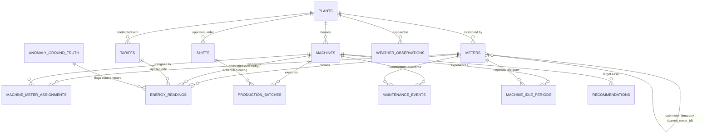

# Entity-Relationship (ER) Diagram & Structural Mappings
## YottaFlex Industrial Energy Analytics Platform

### Entity Cardinalities and Foreign Key Traceability

1. **`plants` (1) to `meters` (N)**
   - Cardinality: `1 : N` (1 plant has 20 meters).
   - FK: `meters.plant_id -> plants.plant_id`.
   - Hierarchy: Main Incomer (MTR-PLT-001-001) has `parent_meter_id = NULL`; Sub-feeders reference Main Incomer; Process/Machine meters reference Sub-feeders.

2. **`meters` (M) to `machines` (N) via `machine_meter_assignments`**
   - Cardinality: `M : N` resolved via bridge table `machine_meter_assignments`.
   - Allows multi-channel sub-metering, shared busbars, or auxiliary cooling loops with effective start/end timestamps and percentage allocations.

3. **`meters` (1) to `energy_readings` (N)**
   - Cardinality: `1 : N` (Each meter produces one reading every 15 minutes: 8,640 intervals per meter across 90 days = 172,800 baseline records).
   - FK: `energy_readings.meter_id -> meters.meter_id`.

4. **`tariffs` (1) to `energy_readings` (N)**
   - Cardinality: `1 : N`.
   - FK: `energy_readings.tariff_id -> tariffs.tariff_id`.
   - Effective date and hourly matching: Off-Peak, Shoulder, On-Peak, Critical Peak.

5. **`machines` (1) to `production_batches` (N)**
   - Cardinality: `1 : N` (2,000 batches distributed across production assets).
   - FK: `production_batches.machine_id -> machines.machine_id`.
   - FK: `production_batches.shift_id -> shifts.shift_id`.

6. **`machines` (1) to `machine_idle_periods` (N)**
   - Records starved, blocked, changeover, and off-shift warm standby durations and wasted energy.

7. **`machines` (1) to `maintenance_events` (N)**
   - Records preventive and corrective maintenance windows with zero production output.

8. **`machines` (1) to `recommendations` (N)**
   - Tracks engineering interventions (e.g. VFD installation, standby auto-shutdown, off-peak load shifting).
